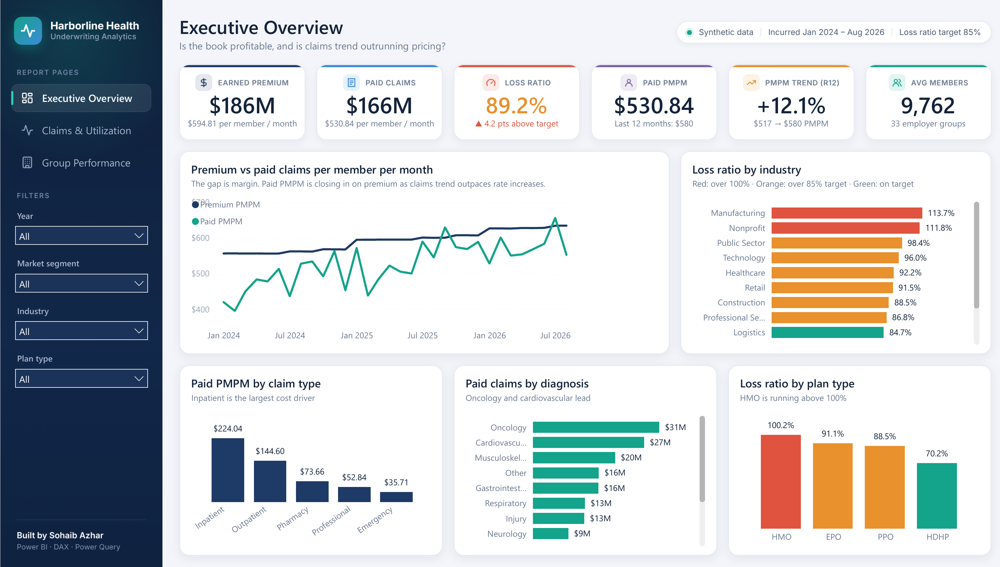

# Large Group Health Plan Performance Dashboard (Power BI)

A three-page Power BI report for a fully insured large-group health plan book. It tracks
earned premium, paid claims, loss ratio, PMPM trend, utilization, denials, high-cost claimants
and group-level renewal experience.

> **Data note:** All data is synthetic, and every group, provider and plan name is fictional.
> The dataset was generated with a seeded Python script (`Data/generate_data.py`) so it behaves
> like a real book: age/gender cost curves, seasonality, utilization and unit-cost trend,
> catastrophic claimants, deductible and OOP accumulators, and claim denials.



---

## How to open it

1. Unzip the folder to **`C:\HealthClaimsDashboard`**. That is the default data path, so it
   works without any changes.
2. Open **`HealthClaims.pbip`** in Power BI Desktop (a recent version).
   - If Desktop asks about preview features, enable **Power BI Project (.pbip) save option**,
     **Store semantic model using TMDL format**, and **Store reports using enhanced metadata
     format (PBIR)** under *File → Options → Preview features*, then restart.
3. Click **Refresh** to load the CSVs (about 217K claim rows, which takes a few seconds).
   - If you unzipped somewhere else: *Transform data → Edit parameters → DataFolder* and enter
     your path, ending with `\`.
4. Optional: use *File → Save as → .pbix* for a single-file copy, or *Publish* to the Power BI
   service to get a shareable link.

---

## Business questions

| Page | Question it answers |
|---|---|
| **Executive Overview** | Is the book profitable? Is claims trend outpacing rate increases? Which industries and plan types are driving losses? |
| **Claims & Utilization** | Where do the claim dollars go (service type, diagnosis, provider, age)? How much is lost to denials, and why? |
| **Group Performance & Renewals** | Which groups need rate action at renewal? Who is priced below their cost? |

## Key findings (full period, no filters)

- **Loss ratio is 89.2% against an 85% target.** It rose from 85.5% in 2024 to 90.7% in 2025
  and 91.3% in 2026 YTD.
- **Claims trend is outrunning pricing.** Rolling 12-month paid PMPM is up **+12.1%**, while
  premium PMPM rose about 5–7% a year ($561 → $600 → $629).
- **172 high-cost claimants (≥ $100K) drive 20.9% of paid claims.** Oncology and cardiovascular
  are the top two diagnosis categories by paid dollars.
- **Inpatient care is the largest cost bucket** at $224 PMPM, followed by outpatient at $145.
- **HMO plans run at a 100.2% loss ratio**, versus 70.2% for HDHP. That points to HMO pricing,
  or to a sicker population selecting HMO.
- **7 groups run above 100%.** The largest is a 1,000+ life manufacturer at 113.7% with 21 HCCs,
  which is the top renewal priority.
- **Denial rate is 6.1%.** Prior authorization and duplicate claims are the top reasons, and
  both are operational problems that can be fixed.

---

## Data model

Star schema with two fact tables at different grains, sharing conformed dimensions.

```
                 ┌──────────┐      ┌──────────┐
                 │  Groups  │      │  Plans   │
                 └────┬─────┘      └────┬─────┘
          ┌───────────┼─────────────────┼───────────┐
          ▼           ▼                 ▼           ▼
   ┌────────────┐                           ┌──────────────┐
   │   Claims   │◄── Date (Service Date)    │  Enrollment  │◄── Date (Month Start)
   │ 1 row/claim│┄┄┄ Date (Paid Date,       │ member months│
   └─┬───────┬──┘     inactive)             │ + premium    │
     │       │                              └──────┬───────┘
     ▼       ▼                                     │
 Providers  Members ◄──── Age Bands ───────────────┘
```

| Table | Grain / purpose |
|---|---|
| `Claims` | One row per claim: billed, allowed, member cost share, paid, status, denial reason |
| `Enrollment` | Member months and earned premium by month × group × plan × age band |
| `Groups`, `Plans`, `Providers`, `Members` | Dimensions |
| `Age Bands` | Conformed dimension so PMPM by age uses claims and member months consistently |
| `Date` | Marked date table. Active link on Service Date (incurred basis), inactive link on Paid Date (cash basis) |
| `Key Measures` | Home table for all 58 measures, organized in display folders |

**Modeling choices**
- PMPM measures divide claims by member months from a separate fact table. This is why
  `Enrollment` is modeled as its own fact, not derived from claims.
- Single-direction relationships only. No bi-directional filters and no ambiguity.
- Implicit measures are turned off (`discourageImplicitMeasures`), and numeric columns are
  hidden so report authors use the governed measures.
- Power Query handles typing, blank-to-null cleanup, renaming and derived columns (days to
  pay, sort keys). The data path is a single parameter.

## DAX highlights

```dax
Loss Ratio = DIVIDE ( [Total Paid], [Total Premium] )

Paid PMPM = DIVIDE ( [Total Paid], [Member Months] )

-- Rolling 12-month claims trend
Paid PMPM (R12) =
VAR LastMonth = MAX ( Enrollment[Month Start] )
VAR Last12Months =
    DATESINPERIOD ( 'Date'[Date], EOMONTH ( LastMonth, 0 ), -12, MONTH )
RETURN
    IF ( NOT ISBLANK ( LastMonth ), CALCULATE ( [Paid PMPM], Last12Months ) )

PMPM Trend % (R12) =
VAR CurrentPMPM = [Paid PMPM (R12)]
VAR PriorPMPM = [Paid PMPM (R12 PY)]
RETURN IF ( NOT ISBLANK ( PriorPMPM ), DIVIDE ( CurrentPMPM - PriorPMPM, PriorPMPM ) )

-- High-cost claimants: member-level iteration
High-Cost Claimants =
VAR Threshold = [HCC Threshold]
RETURN COUNTROWS ( FILTER ( VALUES ( Claims[Member ID] ), [Total Paid] >= Threshold ) )

-- Cash-basis view through the inactive relationship
Total Paid (Paid Date) =
CALCULATE ( [Total Paid], USERELATIONSHIP ( Claims[Paid Date], 'Date'[Date] ) )

-- Measure-driven conditional formatting
Loss Ratio Color =
VAR LR = [Loss Ratio]
RETURN SWITCH ( TRUE (), ISBLANK ( LR ), BLANK (),
    LR > 1, "#C2413B", LR > [Loss Ratio Target], "#E39B2D", "#2C8C6F" )
```

**Measure folders:** Financials · Membership · PMPM & Trend · Utilization · High-Cost
Claimants · Formatting.

## Skills demonstrated

Dimensional modeling (multi-fact star schema, conformed dimensions, role-playing date) · Power
Query (M) · DAX (time intelligence, iterators, variables, USERELATIONSHIP, measure-based
conditional formatting) · report design (KPI hierarchy, consistent theme, synced slicers) ·
healthcare finance domain (loss ratio, PMPM, trend, HCC, utilization per 1,000) · source
control-friendly Power BI Project format (TMDL + PBIR).

## Report design

- **Dark sidebar** with page navigation buttons and four filters (Year, Market segment,
  Industry, Plan type). The filters are synced across all three pages.
- **KPI cards** each show a headline value and a context line, such as "▲ 4.2 pts above
  target" or "$517 → $580 PMPM". These come from text measures in the *7. KPI Labels* folder.
- **Designed page backgrounds** (sidebar, header and card shells) are PNGs under
  `StaticResources/RegisteredResources`, and the visuals sit on top of them. If you move a KPI
  card, regenerate or edit the background to match.
- **One color rule everywhere:** green is at or below the 85% target, orange is above target, and
  red is above 100%. This is driven by the `Loss Ratio Color` measure.

## Repository layout

```
HealthClaims.pbip                  ← open this in Power BI Desktop
HealthClaims.SemanticModel/        ← model in TMDL (tables, measures, relationships)
HealthClaimsDashboard.Report/               ← report pages and visuals in PBIR JSON, custom theme
Data/                              ← CSV source files + generate_data.py
Screenshots/                       ← page previews
LINKEDIN_POST.md                   ← draft post for sharing the project
```

> The images in `Screenshots/` are previews rendered from the same data and layout. After you
> refresh in Power BI Desktop, replace them with real screenshots of the report.
